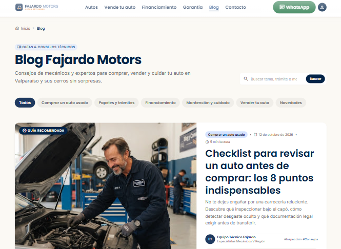
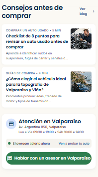
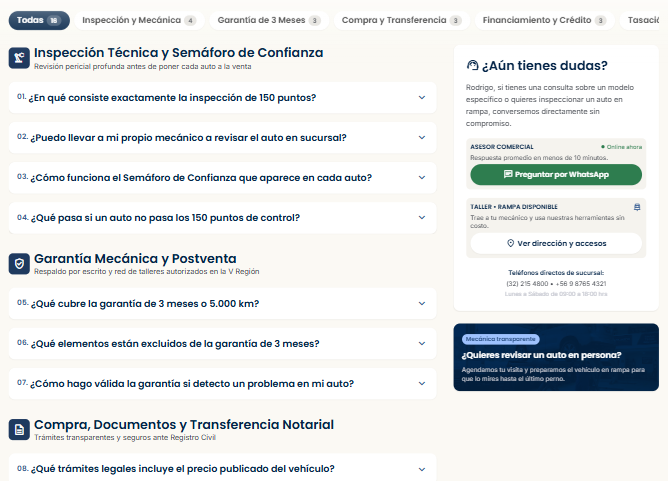
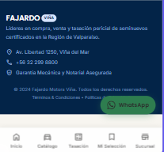

# QA — [Fajardo Motors V]

> Guía: [QA y coherencia](../evaluacion/guias/fase-3-prototipo/02-qa-y-coherencia.md)

## Prototipo en Stitch

> Guía: [Prototipo en Stitch](../evaluacion/guias/fase-3-prototipo/01-prototipo-en-stitch.md)

**Proyecto:** [https://stitch.withgoogle.com/projects/2050693211074279070]

<!-- Capturas en docs/img/, por ejemplo:  -->

| Pantalla | Desktop | Mobile |
|---|---|---|
| Landing |  |  |
| Tienda |  |  |
| Ficha de producto |   |   |
| Carrito |  |  |
| Blog |  |  |
| Artículo |  | |

## Revisión: spec vs. prototipo

<!-- Una fila por diferencia. Resultado: ✅ / ❌ → ✅ / ❌ -->

| Pantalla | Qué dice la spec | Qué generó Stitch | Corrección ||
|---|---|---|---|---|
|  | La spec mencionaba principalmente a Valparaiso, de hecho una de las palabras que ocupo como principal es porteño. | Se centro específicamente en todo lo que es solo Viña del Mar, incluyendo la direccion de la sucursal. | Corregi poniendo que el enfoque fuera Valparaíso de todas las paginas, pero no lo completo con todas, trate de varias maneras, pero sigue habiendo errores. | 

## Mejoras a mis specs

<!-- Qué cambiaste en DESIGN.md o en tus prompts después de ver el resultado. -->

- Cambie varias cosas, especialmente cosas que tienen que ver con el diseño y el orden de las cosas tanto en la forma desktop como en la forma mobile, temas de estructura, y cosas que no se veían uniformes y iban cambiando de una a otra, eso me hizo darme cuenta de el enfoque que tenia que darle a la IA para que me diera realmente todo lo que quería y aunque no logre que corrigiera todos los errores quedo mucho mejor que el inicio.

## User flows

| Flujo | Recorrido en el prototipo | ¿Se completa? |
|---|---|---|
| Compra | Landing → clic en "Ver autos" → Tienda → elige un auto con "Ver informe" → Ficha del auto (revisa fotos, informe de inspección y semáforo de confianza) → clic en "Agendar visita" → Mi selección y visita → completa el formulario y confirma con "Agendar visita". Alternativa: desde la ficha o desde Mi selección, clic en "Consultar por WhatsApp". | Sí. Se recorre desde la landing hasta agendar la visita, y el botón de WhatsApp está en las pantallas clave. El formulario de agenda es solo visual: no envía datos ni confirma de verdad, y WhatsApp es un enlace externo que el prototipo no abre. |
| Contenido | Blog → clic en una Tarjeta de artículo ("Leer más") → Artículo "Checklist para revisar un auto antes de comprar" → al terminar, clic en "Mira nuestros autos revisados" → Tienda. También se puede entrar desde las tarjetas de artículo de la landing. | Sí. Se recorre desde el blog hasta la tienda con un llamado a la acción al final del artículo. Los chips de categoría del blog no filtran, solo se ven. |

## Coherencia

- El prototipo responde al brief de Fajardo Motors: una automotora de autos usados en Viña del Mar y Valparaíso que se diferencia por la transparencia. Cada auto muestra su informe de inspección, un semáforo de confianza y una garantía de 3 meses.
- Para la proto-persona, Rodrigo Vega (34 años, supervisor de logística y padre de familia, que compra desde el celular y usa WhatsApp), lo más importante está arriba y más grande: la promesa "Compras tranquilo", el buscador por tipo y presupuesto, y los botones "Ver autos" y WhatsApp.
- Sus frustraciones (fallas ocultas, precios que cambian y falta de respaldo) se resuelven con el sello "Revisado", el informe descargable, el semáforo y la garantía visible en la ficha del auto.
- Los flujos de compra (landing, tienda, ficha y visita) y de contenido (blog, artículo y tienda) se pueden recorrer, y el contacto por WhatsApp está disponible en las pantallas clave.
- La paleta (azul profundo, naranja cálido y blanco cálido) y la tipografía (Poppins para títulos e Inter para textos) transmiten confianza, cercanía y seguridad, las mismas palabras clave del moodboard.
- Desde la Fase 1 cambió el carrito: como un auto no se paga online, pasó a ser "Mi selección y visita", donde se guardan autos y se agenda una visita o se escribe por WhatsApp.
- Por el plazo y porque el sitio se hará solo con HTML y CSS, los filtros, los formularios y el cotizador quedan como prototipo visual, y se priorizaron el informe de inspección y la tasación en 24 h porque respaldan la propuesta de valor.
