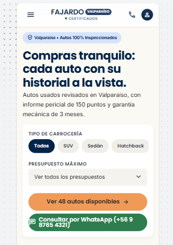
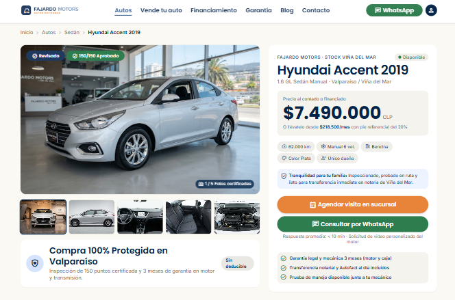
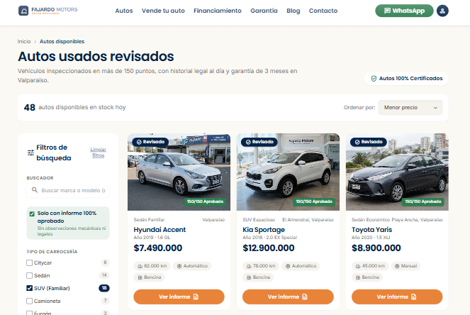

# QA — [Fajardo Motors V]

> Guía: [QA y coherencia](../evaluacion/guias/fase-3-prototipo/02-qa-y-coherencia.md)

## Prototipo en Stitch

> Guía: [Prototipo en Stitch](../evaluacion/guias/fase-3-prototipo/01-prototipo-en-stitch.md)

**Proyecto:** [https://stitch.withgoogle.com/projects/2050693211074279070]

<!-- Capturas en docs/img/, por ejemplo:  -->

| Pantalla | Desktop | Mobile |
|---|---|---|
| Landing |  |  |
| Tienda |  |  |
| Ficha de producto |   |   |
| Carrito | | |
| Blog | | |
| Artículo | | |

## Revisión: spec vs. prototipo

<!-- Una fila por diferencia. Resultado: ✅ / ❌ → ✅ / ❌ -->

| Pantalla | Qué dice la spec | Qué generó Stitch | Resultado | Corrección |
|---|---|---|---|---|
| | | | | |

## Mejoras a mis specs

<!-- Qué cambiaste en DESIGN.md o en tus prompts después de ver el resultado. -->

-

## User flows

| Flujo | Recorrido en el prototipo | ¿Se completa? |
|---|---|---|
| Compra | | |
| Contenido | | |

## Coherencia

<!-- 5 a 10 líneas: cómo responde el prototipo al brief y a tu proto-persona,
y qué cambió desde la Fase 1 y por qué. -->
